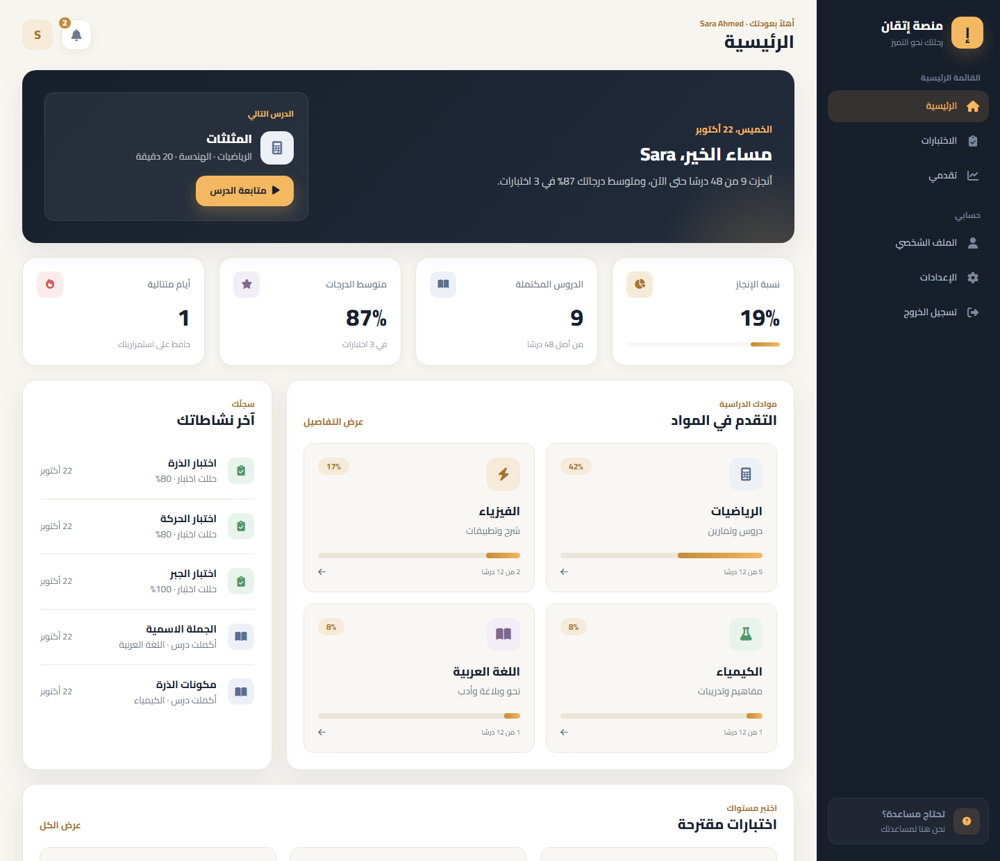
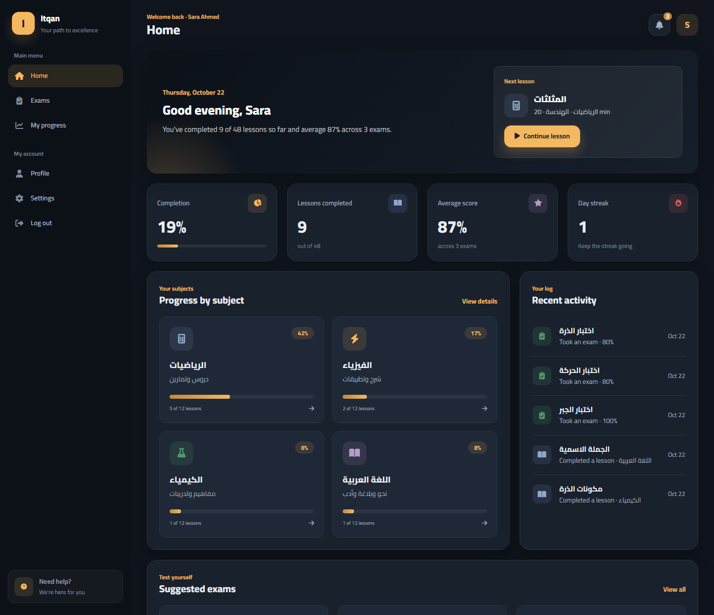
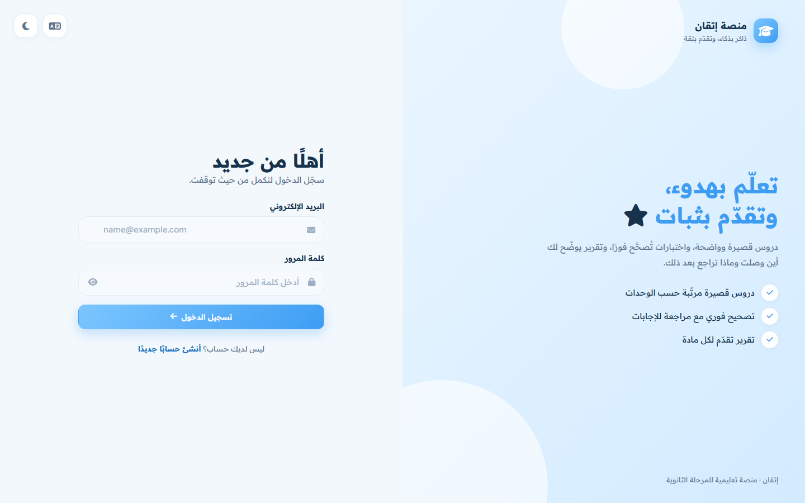
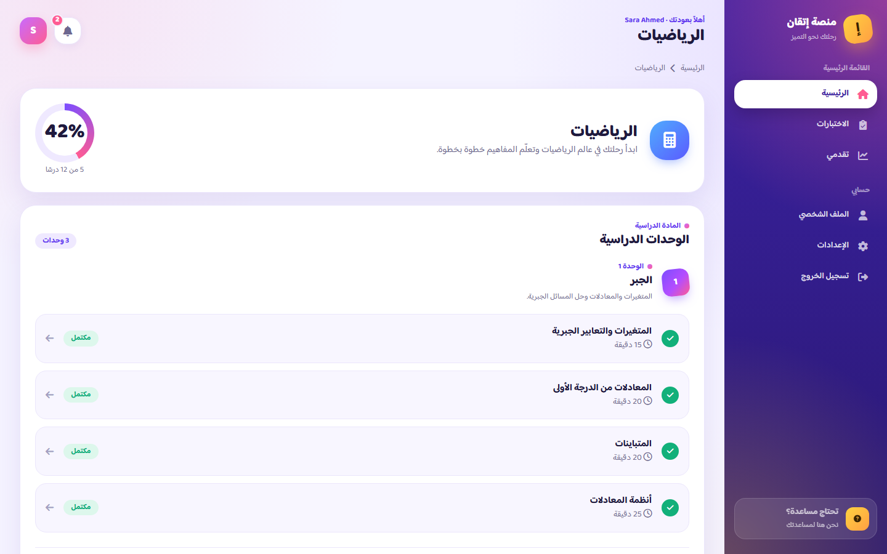
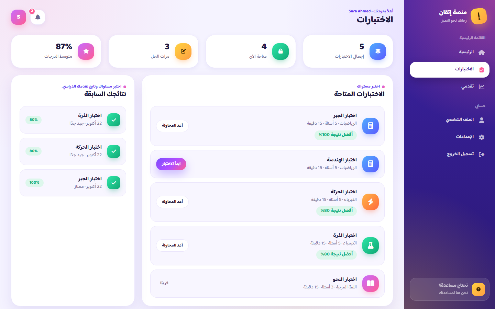
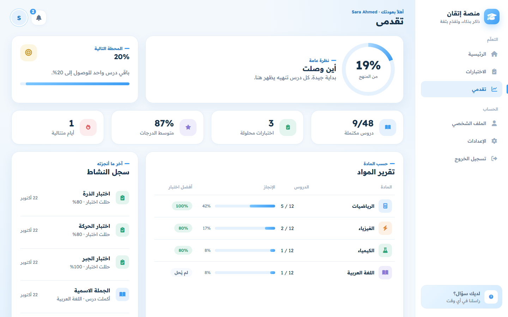
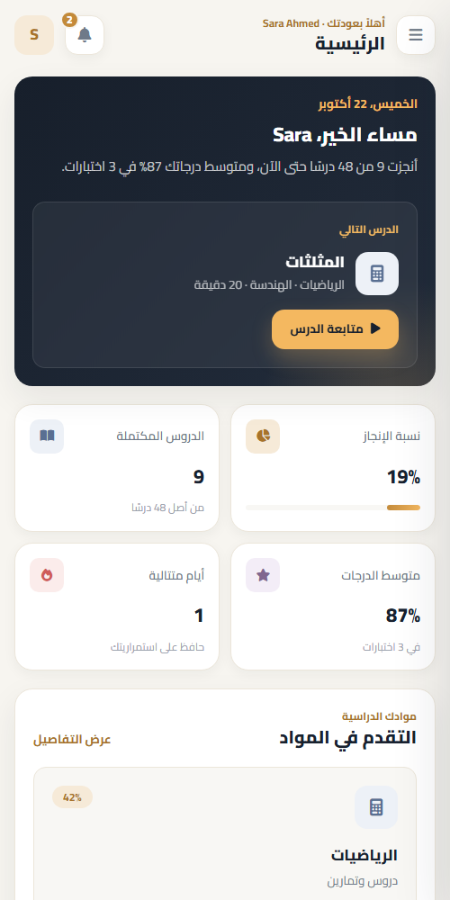

# Itqan — Online Learning Platform

[](https://github.com/amanykhaled4/itqan-learning-platform/actions/workflows/ci.yml)

A bilingual (Arabic / English) learning platform for secondary-school students: lessons organised by subject and unit, timed exams graded on the server, and a personal dashboard that tracks progress.

Built with **ASP.NET Core 10** (REST API, JWT, EF Core + SQLite) and a **vanilla HTML / CSS / JavaScript** front end — no framework, no build step.



## Features

**For students**
- Register and log in (JWT, hashed passwords); protected pages redirect to login when the session expires
- 4 subjects → 12 units → 48 lessons; mark lessons complete and move to the next one
- Timed multiple-choice exams with a progress bar and auto-submit when time runs out
- Answers are graded **on the server** — the correct option is never sent to the browser before submission
- Result screen with score and a per-question review of right and wrong answers
- Home built around "what's next": the next unfinished lesson, the subjects, an exam of the day (untried first, then the weakest score) and a daily study tip
- Progress page: overall percentage, next milestone, key numbers, a subject report (lessons, completion, best exam score) and the activity log
- Profile editing and password change
- Notifications built from the student's real data, an FAQ in the sidebar and a terms-of-use dialog on sign-up

**Interface**
- Arabic (RTL) and English (LTR), switched instantly and saved to the account
- Calm baby-blue and white design with a soft pastel colour per subject
- Each page has one job: **Home** is what to study now (next lesson, subjects, exam of the day, a daily study tip), **Progress** holds the numbers (subject report with best exam score per subject, milestones, activity log), **Profile** is account details only
- Light and dark themes
- Responsive layout: sidebar on desktop, slide-in drawer on phones
- One shared design system (`css/app.css`) used by every page

## Screenshots

| Dashboard — dark mode, English | Login |
|---|---|
|  |  |

| Course | Exams |
|---|---|
|  |  |

| Progress | Mobile |
|---|---|
|  |  |

## Tech stack

| Layer | Technology |
|---|---|
| API | ASP.NET Core 10, controllers, minimal hosting |
| Auth | JWT bearer tokens, ASP.NET Identity `PasswordHasher` |
| Data | Entity Framework Core 10, SQLite, code-first migrations, seed data |
| Docs | Swagger / OpenAPI with an *Authorize* button for testing |
| Front end | HTML5, CSS3 (custom properties, grid, container queries), vanilla JavaScript (ES2020) |
| i18n | Custom dictionary with Arabic plural rules and RTL/LTR switching |

## Run it locally

Requirements: [.NET 10 SDK](https://dotnet.microsoft.com/download).

```bash
git clone https://github.com/amanykhaled4/itqan-learning-platform.git
cd itqan-learning-platform
dotnet run --project backend
```

Open **http://localhost:5111** — the API serves the front end too, so that one command runs the whole platform. The SQLite database is created and filled with subjects, lessons and exams on first run.

**Demo account** — press *Try the demo account* on the login page, or log in with:

| Email | Password |
|---|---|
| `demo@itqan.app` | `demo1234` |

It already has finished lessons and exam results, so every page has something to show. You can also create your own account from the register page.

API documentation: **http://localhost:5111/swagger**

## Tests

```bash
dotnet test Itqan.slnx
```

17 tests in `tests/ItqanApi.Tests`. Most are integration tests that start the real API in memory against a throwaway SQLite database (`WebApplicationFactory`) and check:

- registration, login, duplicate emails, validation, and that a wrong password and an unknown email get the same answer
- every protected endpoint rejects requests without a token
- exam questions never reveal the correct option, grading happens on the server, and the best score is tracked
- unavailable exams can't be submitted, and students only see their own results
- completing a lesson twice counts once, and un-completing it updates progress
- day-streak rules (unit tests)

The same tests run on every push with GitHub Actions (`.github/workflows/ci.yml`).

> Prefer VS Code Live Server for the front end? Open `frontend/` on port 5500; it will call the API on port 5111 automatically (CORS is already allowed in development).

## Project structure

```
backend/
  Controllers/    Auth, Me (profile & settings), Subjects & lessons, Exams, Progress
  Data/           AppDbContext and seed content
  Dtos/           Request / response records with validation attributes
  Models/         Student, Subject, Unit, Lesson, Exam, Question, Option, attempts
  Services/       TokenService (JWT), ProgressService (stats & streaks)
  Migrations/     EF Core migrations
frontend/
  *.html          One page per screen
  css/app.css     Shared design system (tokens, components, dark mode, RTL)
  js/api.js       Fetch wrapper: token handling, errors, expired sessions
  js/i18n.js      Arabic / English dictionary
  js/app.js       Layout, sidebar, notifications, toasts, dialogs
  js/pages/       Page-specific scripts
tests/
  ItqanApi.Tests/ xUnit integration and unit tests
```

## API overview

| Method | Endpoint | Description |
|---|---|---|
| POST | `/api/auth/register` | Create an account, returns a token |
| POST | `/api/auth/login` | Log in, returns a token |
| GET / PUT | `/api/me` | Read or update the profile |
| PUT | `/api/me/settings` | Language, theme, notification preferences |
| PUT | `/api/me/password` | Change password |
| GET | `/api/subjects` | Subjects with the student's progress |
| GET | `/api/subjects/{slug}` | Units and lessons of a subject |
| GET | `/api/lessons/{id}` | Lesson content with previous / next links |
| POST / DELETE | `/api/lessons/{id}/complete` | Mark or unmark a lesson as complete |
| GET | `/api/exams` | Exams with best score and attempt count |
| GET | `/api/exams/{id}` | Questions and options (without answers) |
| POST | `/api/exams/{id}/submit` | Grade answers and return the review |
| GET | `/api/exams/attempts` | Past results |
| GET | `/api/progress` | Overall stats, per-subject progress, recent activity |

All endpoints except register and login need an `Authorization: Bearer <token>` header.

## Configuration

`backend/appsettings.Development.json` contains a development-only JWT key. Outside development the placeholder key is never used: without `Jwt__Key` the API generates a random key at startup (secure, but everyone is logged out when the server restarts). To keep logins across restarts, set your own secret:

```bash
Jwt__Key="a-long-random-secret"
```

## Deploy

The repo includes a `Dockerfile` (API + front end in one container) and a Render Blueprint (`render.yaml`) that generates the JWT secret automatically:

[](https://render.com/deploy?repo=https://github.com/amanykhaled4/itqan-learning-platform)

On the free plan the SQLite database lives inside the container, so it starts fresh (with the demo account) after each restart.

## Notes

- Course content (lessons and exams) is written in Arabic; the interface itself is fully translated.

---

## بالعربي

**إتقان** منصة تعليمية لطلاب المرحلة الثانوية: دروس مقسّمة إلى مواد ووحدات، واختبارات بوقت محدد تُصحَّح على السيرفر، ولوحة تحكم تتابع تقدّم الطالب. الواجهة تدعم العربية والإنجليزية والوضع الليلي وتعمل على الموبايل.

للتشغيل: ثبّت ‎.NET 10 SDK ثم نفّذ `dotnet run --project backend` وافتح http://localhost:5111، واضغط «جرّب الحساب التجريبي» للدخول مباشرة.
